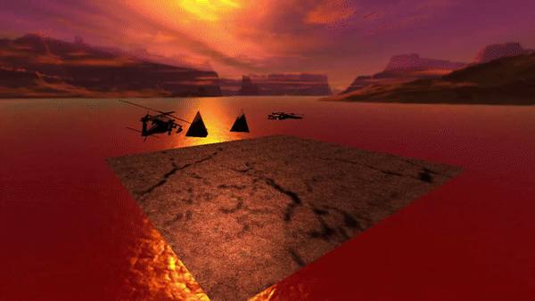

# SALD Sandbox 3D

A 3D sandbox built using [SALD](https://github.com/mayuso/SALD).



## Usage

### Build from source

Ensure you have **CMake** and a **C++ compiler** installed.

**1. Clone the repository**

```bash
git clone https://github.com/mayuso/SALD-Sandbox3D.git --recursive
cd SALD-Sandbox3D
```

**2. Build and Run (Debug)**

For quick testing or development:

```bash
mkdir build
cd build
cmake ..
cmake --build . --parallel
./sald-sandbox3d
```

The build copies `Shaders/`, `Textures/` and `Models/` next to the executable, which loads them from its working directory. With a multi-config generator (Visual Studio) the executable is in `Debug/` instead, so run it from `build/Debug`.

### Release Build

To create a standalone `release` folder containing the optimized executable and all necessary assets (Textures, Shaders, Models):

```bash
mkdir build
cd build
cmake -DCMAKE_BUILD_TYPE=Release ..
cmake --build . --config Release --parallel
cmake --install . --config Release
```

This will generate a `release/` directory in the project root (pass `--prefix <dir>` to `cmake --install` to put it elsewhere). You can then run the game directly from there:

```bash
cd ../release
./sald-sandbox3d
```

### Walking around a town

When `Models/town.obj` exists the app starts in walking mode in that town; otherwise (or with `./sald-sandbox3d demo`) it shows the lighting demo.

| Key | Action |
| --- | --- |
| W A S D / arrows | Walk |
| Mouse | Look around |
| Left Shift | Run |
| Tab | Switch between walking and flying |
| Escape | Free / capture the mouse cursor |
| L | Toggle the torch (demo scene) |

The included town is a bundled example asset: an L-shaped building, an annex, a road and two paths on rolling hills. Buildings are solid (you slide along their walls) and you walk up and down the ground.

The town is a set of files in `src/Models/` and `src/Textures/`; to use your own, replace them (keeping the names) with:

| File | Contents |
| --- | --- |
| `town.obj` + `town.mtl` | The model, in metres, Y up, centred on the origin; textures are loaded from `Textures/` |
| `town.spawn` | `<x> <z> <half width x> <half width z>`: start point, and the walkable area around the origin |
| `town.collision` | One building per line: point count, then `x z` pairs of its footprint outline |
| `town.terrain` | `<cells x> <cells z> <min x> <min z> <cell size x> <cell size z>`, then one row of heights per grid line along +Z; each cell is two triangles split along its (min x, min z)–(max x, max z) diagonal |

Without `town.collision` buildings can be walked through, and without `town.terrain` the ground is flat at height 0.

### Other useful commands (mainly for me)

```bash
# Update submodules
git submodule update --remote --recursive
```

## About

A 3D sandbox created to demonstrate and test the capabilities of the **SALD** engine (OpenGL wrapper).

## Resources

*   [SALD Engine](https://github.com/mayuso/SALD)
